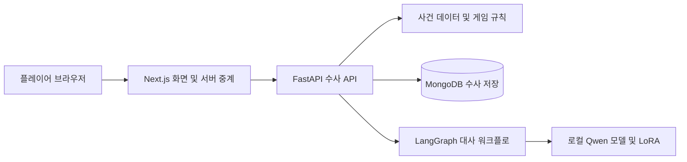

# Click Detective · 딸깍탐정단

증거를 읽고, 용의자의 진술을 비교하고, 흩어진 단서를 연결해 사건의 진실을 밝혀내는 웹 기반 탐정 게임입니다. 플레이어는 사건 자료를 직접 조사하고 용의자에게 질문하며, 수집한 근거를 바탕으로 추론을 완성하고 최종 고발을 제출합니다.

이 저장소는 **Next.js 기반 게임 화면**과 **FastAPI 기반 수사 엔진·로컬 AI 대사 생성 서버**를 함께 포함합니다. 브라우저에서 수행한 조사는 백엔드의 게임 규칙에 따라 처리되고, 수사 상태와 메모는 MongoDB에 저장됩니다.

코드를 수정할 때는 [기여 가이드](CONTRIBUTING.md)에서 작업 규칙과 검증 절차를 확인하세요.

## 목차

- [프로젝트 소개](#프로젝트-소개)
- [주요 기능과 플레이 흐름](#주요-기능과-플레이-흐름)
- [시스템 구성](#시스템-구성)
- [AI 대사 생성 방식](#ai-대사-생성-방식)
- [기술 스택](#기술-스택)
- [폴더 구조](#폴더-구조)
- [설치 및 실행](#설치-및-실행)
- [검사 및 테스트](#검사-및-테스트)
- [문제 해결과 상세 문서](#문제-해결과-상세-문서)

## 프로젝트 소개

딸깍탐정단은 자료 열람, 심문, 추론과 고발을 하나의 수사 과정으로 연결합니다. 단순히 대화만 진행하는 형태가 아니라, 플레이어가 확보한 증거와 현재 조사 단계에 따라 공개되는 정보와 가능한 행동이 달라집니다.

사건 소개와 오프닝에서 수사를 시작하고, 증거 보관실에서 자료를 읽으며, 관련 자료를 용의자에게 제시해 진술을 확인할 수 있습니다. 이후 증거와 증언을 조합해 추론 문서를 만들고, 범인·동기·수법 및 근거를 선택하여 사건을 마무리합니다.

프런트엔드는 플레이어의 조작과 결과 표시를 담당하고, 백엔드는 자료 공개 조건부터 진행률·고발 채점까지 수사 규칙을 관리합니다. 로컬 LLM은 승인된 사건 사실을 바탕으로 캐릭터 대사를 표현하는 역할을 맡습니다.

## 주요 기능과 플레이 흐름

| 단계 | 기능 | 설명 |
| --- | --- | --- |
| 사건 선택 | 홈·사건 기록실 | 사건 소개 확인, 새 수사 시작 및 진행 중인 수사 이어하기 |
| 도입 | 오프닝 | 사건의 배경과 분위기를 소개하는 화면·영상 |
| 자료 조사 | 증거 보관실 | 확보한 증거와 자료 열람, 분류 및 검색 |
| 심문 | 용의자 대화 | 질문이나 자료 제시를 통해 진술 확인 및 쟁점 발견 |
| 추론 | 자료 조합 | 획득한 출처를 조합하여 새로운 추론 문서 생성 |
| 조사 확장 | 단계 전환 | 조건 충족 시 다음 조사 단계와 추가 자료 공개 |
| 수사 정리 | 메모·진행률 | 메모 자동 저장 및 현재 수집 상태 확인 |
| 사건 종결 | 고발·판정 | 범인·동기·수법과 근거 제출, 규칙에 따른 결과 확인 |

고발은 진행률과 관계없이 제출할 수 있으며, 판정 후 수사가 종결됩니다. 충분히 조사한 뒤 제출하는 것이 좋습니다.

## 시스템 구성



### Next.js: 게임 화면과 서버 중계

`click_detective_Next_js`는 홈, 자료 열람, 심문, 추론, 고발 등의 화면과 반응형 스타일을 제공합니다. Route Handlers가 브라우저 요청을 FastAPI로 중계하는 BFF(Backend for Frontend) 역할을 수행합니다.

서비스 API 키는 Next.js 서버에서 사용하고, 수사 접근에 필요한 게임 토큰은 HttpOnly 쿠키로 관리합니다. 프런트엔드에 사건 정답·추론 규칙·모델 파일을 복사하지 않습니다.

### FastAPI: 수사 엔진과 데이터 관리

`click_detective_FastAPI`는 사건·인물·자료 조회, 증거 열람, 심문, 추론, 조사 단계 전환, 메모 저장, 고발 판정을 처리합니다. 사건의 정적 데이터와 비공개 규칙을 읽고 MongoDB에 수사 상태를 보관합니다.

변경 요청에는 요청 식별자와 상태 버전을 사용해 중복 요청과 오래된 상태에서의 변경을 처리합니다. 자료와 이미지도 현재 수사에서 열람할 수 있는지 확인한 뒤 제공합니다.

## AI 대사 생성 방식

실제 모델 모드에서는 로컬 **Qwen2.5-7B-Instruct**를 NF4 4비트로 로딩하고, 기존에 학습된 **LoRA 어댑터**를 적용합니다. 이 저장소에서 새 학습을 수행하지는 않습니다.

심문에서는 백엔드가 현재 수사에서 공개 가능한 진술을 먼저 정합니다. 자유 질문은 E5와 ChromaDB로 관련 진술을 찾고, Kiwi BM25로 후보의 순서를 조정합니다. LangGraph 워크플로는 선택된 진술을 바탕으로 대사를 생성하고 의미와 응답 형식을 검증합니다. [자유 심문 RAG 변경 정리](click_detective_FastAPI/docs/변경이력/자유_심문_RAG_변경_정리.md)

게임 상태 변경과 정답 판정은 게임 규칙이 담당합니다. 모델 생성 실패 시에는 기본 설정에 따라 승인된 원문 응답으로 복구합니다.

| 실행 모드 | 동작 | 용도 |
| --- | --- | --- |
| `fixture` | 실제 모델 없이 원문 조립 응답 사용 | GPU 없는 개발, 화면 연결 및 게임 흐름 확인 |
| `local` | 로컬 Qwen·NF4·LoRA로 대사 생성 | 실제 LLM을 사용하는 플레이 및 모델 검증 |

`fixture` 실행 결과는 실제 모델의 대사 품질을 의미하지 않습니다.

## 기술 스택

| 영역 | 기술 |
| --- | --- |
| 프런트엔드 | Next.js 16.4.6, React 19.3.1, TypeScript 5 |
| UI·스타일 | CSS, 반응형 스타일시트, Lucide React |
| 서버 중계 | Next.js App Router, Route Handlers, Fetch API |
| 백엔드 | Python 3.11 이상, FastAPI, Uvicorn |
| 데이터 검증·설정 | Pydantic, pydantic-settings |
| 저장 | MongoDB replica set 및 계정용 PostgreSQL |
| 대화 워크플로 | LangGraph |
| 모델 실행 | Qwen2.5-7B-Instruct, PyTorch, Transformers, Accelerate |
| 양자화·어댑터 | bitsandbytes(NF4), PEFT(LoRA) |
| 테스트 | pytest, pytest-asyncio, HTTPX, Node.js 테스트 러너, Playwright |

의존성 기준은 [백엔드 pyproject.toml](click_detective_FastAPI/pyproject.toml)과 [프런트엔드 package.json](click_detective_Next_js/package.json)입니다.

## 폴더 구조

```text
project/
├── README.md                         # 전체 프로젝트 안내
├── click_detective_FastAPI/
│   ├── README.md                     # 백엔드 구조와 실행 안내
│   ├── app/
│   │   ├── main.py                   # FastAPI 진입점과 API
│   │   ├── runtime/                 # 설정, 서비스 인증과 앱 수명
│   │   ├── auth/                    # 계정 인증과 PostgreSQL 저장
│   │   ├── cases/                   # 사건 원본과 공개 카탈로그
│   │   ├── dialogue/                # LLM·검색·검증 워크플로
│   │   └── investigation/           # 수사 규칙과 MongoDB 저장
│   ├── data/                         # 사건 데이터와 자산
│   ├── models/                       # 별도로 준비하는 로컬 모델
│   ├── adapters/                     # 기존 LoRA 어댑터
│   ├── tests/                        # 백엔드 테스트
│   ├── docs/                         # 백엔드 상세 문서
│   ├── .env.example                  # 백엔드 설정 예제
│   └── pyproject.toml                # Python 의존성
└── click_detective_Next_js/
    ├── README.md                     # 프런트엔드 구조와 실행 안내
    ├── app/                          # 페이지·서버 라우트
    │   └── game/                     # 게임 상태·요청·훅·타입
    ├── components/                   # 기능별 화면과 팝업
    ├── styles/                       # 전역·화면별·반응형 CSS
    ├── shared/api/                   # 브라우저 공통 요청
    ├── server/proxy/                 # FastAPI 서버 중계
    ├── hooks/ 와 lib/                # 이전 import 경로 호환
    ├── scripts/                      # 통합·UI 검사 스크립트
    ├── tests/                        # 프런트엔드 테스트
    ├── docs/                         # 프런트엔드 상세 문서
    ├── .env.local.example            # 프런트엔드 설정 예제
    └── package.json                  # npm 의존성과 실행 명령
```

## 설치 및 실행

아래 명령은 Linux/macOS의 Bash 환경 기준입니다. 각 단계의 `~/project`는 실제 저장소 경로로 바꿔 실행하세요. 백엔드와 프런트엔드는 서로 다른 터미널에서 실행합니다.

### 1. 준비 사항

- Python **3.11 이상**
- Node.js **22.18.0 이상** 및 npm
- 수사 저장용 MongoDB replica set. [MongoDB 설치와 연결](click_detective_FastAPI/docs/서버/MongoDB_설치와_실행.md)
- 실제 모델 사용 시 호환되는 NVIDIA GPU·드라이버·CUDA 환경과 모델·어댑터 파일

화면과 수사 기능만 먼저 확인한다면 GPU가 필요 없는 `fixture` 모드로 시작할 수 있습니다.

### 2. 백엔드 설치

```bash
cd ~/project/click_detective_FastAPI
python3 -m venv .cd_venv
source .cd_venv/bin/activate
python -m pip install --upgrade pip
python -m pip install -e '.[dev]'
```

#### 백엔드 환경변수 예시

FastAPI는 `click_detective_FastAPI/.env`에서 설정을 읽습니다. 아래 예시를 참고해 서비스 키, DB 주소, 실행 모드를 각자의 환경에 맞게 정하고 파일에 직접 적용하세요.

```dotenv
CLICK_API_KEY=replace-with-your-service-key
CLICK_GENERATION_MODE=fixture
CLICK_MONGO_URI=mongodb://127.0.0.1:27017/?replicaSet=rs0
```

- `CLICK_API_KEY`는 16자 이상의 서비스 키입니다. Next.js의 `CLICK_DETECTIVE_API_KEY`와 같은 값을 사용합니다.
- `CLICK_GENERATION_MODE`는 GPU 없이 연결을 확인할 때 `fixture`, 실제 모델을 사용할 때 `local`로 설정합니다.
- `CLICK_MONGO_URI`에는 실제 MongoDB 호스트, 포트와 replica set 이름을 지정합니다. 인증이 필요한 배포에서는 해당 연결 문자열에 인증 정보도 포함합니다. [MongoDB 설정](click_detective_FastAPI/docs/서버/MongoDB_설치와_실행.md)
- 계정 기능을 사용할 때는 `CLICK_POSTGRES_DSN`과 `CLICK_AUTH_JWT_SECRET`도 설정합니다. JWT 서명 키는 32바이트 이상이어야 합니다. [계정과 수사 저장소](click_detective_FastAPI/docs/시작하기/05_계정과_수사_저장소.md)

[FastAPI 전체 설정 예제](click_detective_FastAPI/.env.example)

### 3. 백엔드 실행 — 터미널 A

```bash
cd ~/project/click_detective_FastAPI
source .cd_venv/bin/activate
python -m uvicorn app.main:app --host 127.0.0.1 --port 8000 --workers 1
```

서버 시작 완료 후 상태를 확인합니다.

```bash
curl http://127.0.0.1:8000/healthz
```

정상 응답은 `{"status":"ok"}`입니다. API 문서는 http://127.0.0.1:8000/docs 에서 확인할 수 있습니다. 게임 API는 Bearer 서비스 키 인증을 사용하며, 수사별 API에는 게임 토큰도 필요합니다.

### 4. 프런트엔드 설치 및 설정 — 터미널 B

```bash
cd ~/project/click_detective_Next_js
npm ci
```

아래는 Next.js의 `.env.local`에 넣을 설정 예시입니다. 실제 FastAPI 주소와 서비스 키를 확인해 `click_detective_Next_js/.env.local`에 직접 적용하세요. [Next.js 설정 예제](click_detective_Next_js/.env.local.example)

```dotenv
CLICK_DETECTIVE_API_URL=http://127.0.0.1:8000
CLICK_DETECTIVE_API_KEY=replace-with-your-service-key
CLICK_DETECTIVE_TIMEOUT_MS=120000
```

`CLICK_DETECTIVE_API_KEY`는 백엔드 `.env`의 `CLICK_API_KEY`와 정확히 같아야 합니다. 서비스 키는 Next.js의 서버 전용 환경변수로 관리합니다.

### 5. 프런트엔드 실행

```bash
npm run dev
```

브라우저에서 **http://localhost:3000** 에 접속합니다. 홈 → 사건 시작 → 오프닝 → 자료 열람 → 용의자 심문 순서로 연결 상태를 확인할 수 있습니다.

### 6. 실제 로컬 LLM 사용

백엔드 가상환경에서 모델용 의존성을 설치합니다. PyTorch와 CUDA의 호환성을 확인해야 합니다.

```bash
cd ~/project/click_detective_FastAPI
source .cd_venv/bin/activate
python -m pip install -e '.[local,embeddings]'
```

아래는 local 모드 설정 예시입니다. Qwen, 학습된 LoRA 어댑터, 검색·문장 검증 모델 파일을 준비한 뒤 실제 경로를 FastAPI의 `.env`에 직접 적용하세요.

```dotenv
CLICK_GENERATION_MODE=local
CLICK_LOCAL_MODEL_PATH=./models/Qwen2.5-7B-Instruct
CLICK_LORA_ADAPTER_PATH=./adapters/best_adapter
CLICK_RAG_EMBEDDING_DIR=./models/retrieval
CLICK_VALIDATION_EMBEDDING_MODEL=/path/to/validation-model
```

기존 fixture 서버를 종료한 뒤, 모드를 덮어쓰는 환경변수 없이 실행합니다.

```bash
python -m uvicorn app.main:app --host 127.0.0.1 --port 8000 --workers 1
```

모델 로딩이 끝나고 서버 시작이 완료된 뒤 플레이합니다. 설정된 모델이나 어댑터가 없으면 서버가 시작되지 않습니다. 각 모델과 어댑터의 파일 구성은 [모델 안내](click_detective_FastAPI/models/README.md)를 참고하세요.

### 주요 환경변수

| 파일 | 변수 | 설명 |
| --- | --- | --- |
| 백엔드 `.env` | `CLICK_API_KEY` | Next.js 서버 인증용 키, 16자 이상 |
| 백엔드 `.env` | `CLICK_GENERATION_MODE` | `fixture` 또는 `local` |
| 백엔드 `.env` | `CLICK_MONGO_URI` | 필수 MongoDB replica set 연결 문자열 |
| 백엔드 `.env` | `CLICK_DATA_DIR` | 기본값 `./data` |
| 백엔드 `.env` | `CLICK_LOCAL_MODEL_PATH` | 로컬 모델 폴더 |
| 백엔드 `.env` | `CLICK_LORA_ADAPTER_PATH` | LoRA 어댑터 폴더 |
| 프런트엔드 `.env.local` | `CLICK_DETECTIVE_API_URL` | Next.js에서 접근 가능한 백엔드 주소 |
| 프런트엔드 `.env.local` | `CLICK_DETECTIVE_API_KEY` | 백엔드 서비스 키와 같은 값 |
| 프런트엔드 `.env.local` | `CLICK_DETECTIVE_TIMEOUT_MS` | 백엔드 요청 제한 시간(밀리초) |

모델 폴더처럼 경로로 정의된 백엔드 설정은 상대 경로를 FastAPI 프로젝트 폴더 기준으로 해석합니다. 검증 모델은 로컬 폴더의 절대 경로 또는 미리 캐시에 준비한 모델 ID를 사용할 수 있습니다. 환경변수를 수정하면 해당 서버를 재시작합니다.

### 배포용 프런트엔드 실행

개발 서버를 종료한 뒤 실행합니다. 백엔드는 별도로 실행되어 있어야 합니다.

```bash
cd ~/project/click_detective_Next_js
npm run build
npm run start
```

코드를 수정했다면 다시 빌드합니다. 서버·컨테이너를 분리하는 경우 `CLICK_DETECTIVE_API_URL`에는 Next.js에서 접근할 수 있는 주소를 지정합니다.

## 검사 및 테스트

### 백엔드

개발 의존성을 설치한 가상환경에서 실행합니다.

```bash
cd ~/project/click_detective_FastAPI
source .cd_venv/bin/activate
python -m pytest -q
```

### 프런트엔드

```bash
cd ~/project/click_detective_Next_js
npm run typecheck
npm test
npm run build
```

### 통합 및 UI 검사

통합 검사는 형제 `click_detective_FastAPI`의 가상환경과 빌드된 Next.js를 사용해 별도 fixture 서버와 임시 DB를 실행합니다. 백엔드 경로가 다르면 `CLICK_TEST_BACKEND_DIR`, Python 경로가 다르면 `CLICK_TEST_PYTHON`을 지정합니다.

```bash
cd ~/project/click_detective_Next_js
npm run test:integration
```

UI 검사는 Playwright Chromium과 비교할 이전 프런트엔드 소스를 추가로 준비합니다.

```bash
npx playwright install chromium
CLICK_TEST_ORIGINAL_DIR=/비교할/이전/프런트엔드 npm run test:ui
```

통합 검사 결과는 프런트엔드의 `.reports/integration.json`에 저장됩니다. fixture·모의 모델 검사는 실제 LLM 품질 검사와 구분해야 합니다. 실제 모델 검증 방법은 [실서버 검사 안내](click_detective_FastAPI/docs/테스트/실서버_LLM_검사.md)에 있습니다.

## 문제 해결과 상세 문서

| 증상 | 확인 사항 |
| --- | --- |
| 화면에서 사건을 불러오지 못함 | FastAPI 실행 여부, `/healthz` 응답, 프런트엔드의 API 주소 확인 |
| API에서 401 응답 | 양쪽 환경변수의 서비스 키 일치 여부 및 서버 재시작 확인 |
| local 모드 시작 실패 | 모델·어댑터 파일, 경로, GPU와 CUDA 및 모델 의존성 확인 |
| 변경한 설정이 적용되지 않음 | 해당 서버 재시작, 프로세스 환경변수의 설정 덮어쓰기 여부 확인 |
| 포트 사용 중 오류 | 기존 서버 종료 또는 포트 변경, 연결 주소도 함께 수정 |
| 통합 검사에서 백엔드를 찾지 못함 | `CLICK_TEST_BACKEND_DIR`와 `CLICK_TEST_PYTHON` 및 설치된 백엔드 의존성 확인 |

프로젝트별 설정과 구현 설명은 다음 문서에서 확인할 수 있습니다.

- [FastAPI 프로젝트 README](click_detective_FastAPI/README.md)
- [Next.js 프로젝트 README](click_detective_Next_js/README.md)
- [백엔드 문서 목차](click_detective_FastAPI/docs/README.md)
- [프런트엔드 문서 목차](click_detective_Next_js/docs/README.md)
- [API별 역할](click_detective_FastAPI/docs/API/상세/README.md)
- [LLM 양자화와 대화 워크플로](click_detective_FastAPI/docs/에이전트/README.md)
- [화면 사용법](click_detective_Next_js/docs/화면/화면_사용법.md)

수집 조건·최소 통과 조건 등 일부 문서에는 사건의 정답과 쟁점이 포함되어 있습니다.
