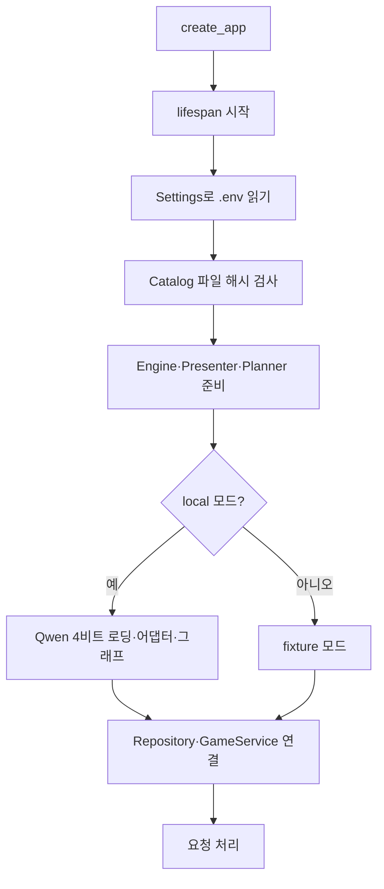

# 03. 프로젝트 구조와 처리 흐름

[목차](README.md) · [Python 파일별 상세](파이썬_파일별_상세/README.md)

## 1. 폴더 구조

```text
click_detective/
├── app/
│   ├── main.py          # 현재 18개 업무 API·인증·서버 시작
│   ├── config.py        # CLICK_ 설정
│   ├── catalog.py       # 정적 데이터·무결성·공개 카탈로그
│   ├── schemas.py       # 사용자 행동 DTO
│   ├── repository.py    # SQLite·게임 토큰·요청 예약·확정
│   ├── service.py       # 행동 처리 순서 조정
│   ├── presentation.py  # 공개 상태·진행률·자료 목록·타임라인
│   ├── domain/
│   │   ├── engine.py    # 게임 규칙·확정할 기록 계산
│   │   └── planning.py  # 심문 공개 승인 계획
│   └── dialogue/        # 모델·프롬프트·LangGraph·검증·RAG
├── data/
│   ├── public/          # public의 이미지·영상 전체 복사
│   ├── case/            # 런타임 정적 사건 JSON
│   ├── scenarios/       # 원본 시나리오 전체 복사
│   └── manifest.json    # 복사 파일 경로·크기·SHA-256
├── tests/               # 내부 데이터·임시 DB·모의 모델 검사
├── Qwen2.5-7B-Instruct/  # 현재 사용자가 보유한 기본 모델
├── models/              # 기본 경로 안내 문서
├── adapters/            # 사용자가 복사할 기존 어댑터
├── .cd_venv/            # 지정한 가상환경
├── .data/               # 실행 후 DB·진단 파일
├── .reports/            # pytest·실서버·130개 심문 보고서
├── docs/                # 설명 문서
└── scripts/             # 실제 HTTP 검사 3개·130개 실행 도구
```

API는 별도 빈 패키지 없이 main.py에서 등록합니다. 실제 경로는 main.py의 create_app() 안에 있습니다. scripts/test_llm_api_live.py는 이미 실행 중인 서버를 호출하는 별도 도구입니다. 이전 share_backend의 실행 도구를 이 프로젝트에 있는 것처럼 사용하면 안 됩니다.

## 2. 서버 시작



main.create_app() 호출만으로 모델을 로딩하지 않습니다. lifespan이 시작될 때 준비합니다. 테스트는 create_app(settings)로 실제 .env를 우회합니다.

## 3. 일반 조회

HTTP 요청 → 서비스 인증 → 수사 토큰 검사(수사 경로) → 버전 검사 → 저장 상태 읽기 → Presenter가 공개 값 계산 → JSON 반환입니다. GET은 질문 수나 열람 상태를 변경하지 않습니다.

## 4. 상태 변경

HTTP 입력 DTO 검사 → 인증 → Repository.reserve() → Engine.require_active() → 행동별 규칙/모델 → Repository.commit() → 공개 상태 반환 순서입니다. finally에서 자신의 미완료 예약을 정리합니다.

reserve와 commit 사이에는 DB 트랜잭션이 계속 열려 있지 않습니다. 모델이 느리게 실행되는 동안 다른 요청의 짧은 DB 작업이 가능하며, 확정 시 최신 revision이 다르면 오래된 결과를 거절합니다.

## 5. 어떤 파일부터 읽나요?

1. main.py에서 경로와 입력 DTO 확인.
2. service.py에서 호출 순서 확인.
3. domain/engine.py 또는 planning.py에서 규칙 확인.
4. repository.py에서 저장·중복·충돌 처리 확인.
5. presentation.py에서 화면으로 나가는 값 확인.
6. 심문이면 dialogue/interrogation_graph.py부터 모델 경로 확인.

DB에 저장한 원본 상태와 화면 응답은 같지 않습니다. 진행률·자료 목록·타임라인 같은 계산값은 Presenter에서 다시 구성합니다.

## 심문의 대사 복구 분기

Planner 승인 계획 → GameService.reply → 정상 생성(stop) / 정보 없음(fixed) / 승인 원문 복구(fallback) → Engine.record_plan → Repository.commit 순서입니다. 기본 복구가 성공하면 대화·질문 1회·승인된 증언/쟁점을 확정합니다. strict 실패나 상태 충돌처럼 확정되지 않은 작업만 abort 후 재시도 대상이 됩니다. [상세 정책](12_질문_응답과_복구_정책.md)
