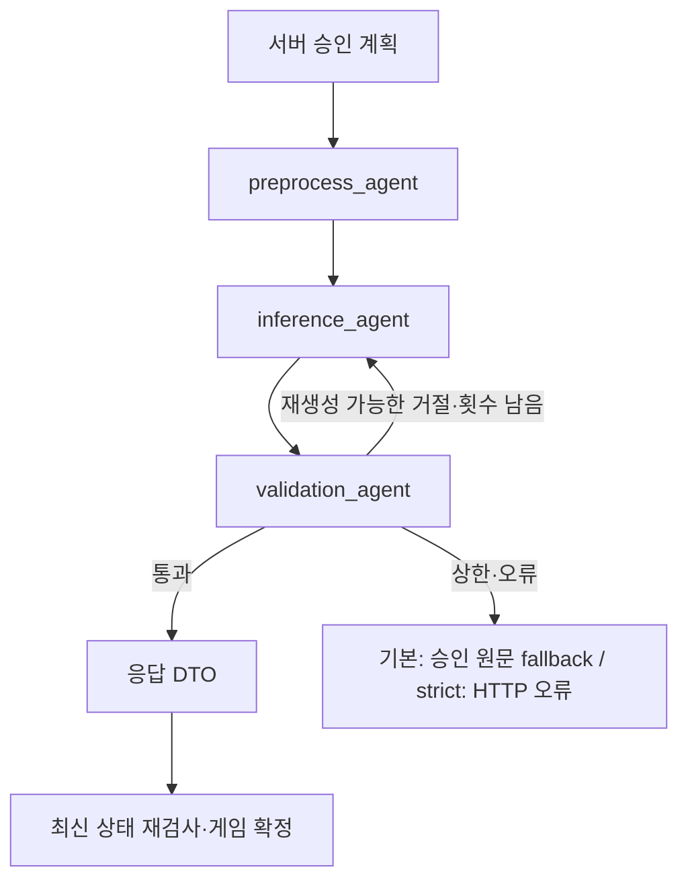

# 05. LLM·양자화·멀티에이전트

[목차](README.md) · [그래프 코드 상세](파이썬_파일별_상세/app/dialogue/interrogation_graph.md)

## 1. 규칙과 생성의 역할

Planner가 말해도 되는 사실·기록 ID·새 쟁점을 결정합니다. 모델은 이를 캐릭터 말투로 표현합니다. 질문 횟수·자료 획득·추론 결론·정답은 모델이 결정하지 않습니다.

서비스는 계획의 모든 사실 ID를 required_fact_ids로 지정합니다. 따라서 현재 일반 게임 요청은 모든 계획 사실을 보존해야 합니다. RAG가 있다고 필수 사실을 줄일 수 있는 것은 아닙니다.

## 2. LangGraph의 세 노드



| 노드             | 실제 처리                                             | 모델 호출      |
| ---------------- | ----------------------------------------------------- | -------------- |
| preprocess_agent | 승인 검색·필수 보존·질문 정규화·이력 제한·메시지 구성 | 없음           |
| inference_agent  | 대사 원문 생성, 시도 횟수·추론 오류 기록              | 생성 호출      |
| validation_agent | 형식·ID·규칙 검사, 별도 의미 검증·재시도 결정         | 의미 검증 호출 |

세 개의 거대 모델을 로딩하지 않습니다. 모델 객체 하나를 생성과 검증에 공유합니다. 그래프 checkpointer는 설정하지 않아 중간 상태를 별도 그래프 DB로 영속화하지 않습니다.

## 3. 전처리와 제한 RAG

검색 대상은 allowed_facts입니다. 숨겨진 전체 대본·정답·다른 수사의 내용을 검색하지 않습니다. 단어·한국어 두 글자 조각·명시적 ID 겹침으로 관련성을 계산하고 선택 사실 top_k와 필수 사실을 합칩니다.

관련성 점수는 진실·공개 권한 판정이 아닙니다. 현재 서비스는 모든 계획 사실을 필수로 지정하므로 실제 검색 선별 효과는 제한적입니다. 생성 문맥에 제시 자료 본문은 자동 승인하지 않으며, 현재 서비스는 자료의 공개 조건을 판정한 뒤 사실만 모델 DTO로 만듭니다.

## 4. 평문 생성과 API JSON

기본 CLICK_GENERATION_OUTPUT_FORMAT=text이면 모델은 대사 원문만 출력합니다. FastAPI가 최종 JSON 응답에 reply를 넣습니다. json 모드는 내부 생성 결과를 {"reply":"대사"} 형식으로 받습니다. text 모드에서 객체·배열·코드 블록처럼 시작하면 거절합니다.

모델이 출력한 임의 사실 ID는 승인 범위와 중복을 검사합니다. 최종 used_fact_ids는 생성자의 자기 신고만 믿지 않고 별도 검증 결과에서 구성합니다.

## 5. 문장별 검증과 근거 번호

복합 사실은 문장으로 나누어 내부 unit 번호를 붙입니다. 각 사실의 모든 문장이 지원되어야 원래 사실 ID를 인정합니다. 검증 모델은 실제 후보 문장 번호를 선택합니다.

```json
{
  "checks": [
    [0, true, [0]],
    [1, false, []]
  ],
  "has_contradiction": false,
  "has_unsupported_claims": false,
  "history_consistent": true,
  "persona_consistent": true,
  "uncertain": false
}
```

checks의 항목은 [검증 항목 번호, 포함 여부, 근거 후보 문장 번호 목록]입니다. 없는 번호·중복·true인데 빈 근거·false인데 근거가 있는 경우를 거절합니다. 모델이 인용문을 다시 작성하는 방식은 아닙니다.

검증 문맥의 approved_facts.units에는 원래 승인 문장을 한 번씩 보존합니다. verification_units에는 검사할 번호·원래 사실 ID만 넣고 candidate_sentences에 후보 원문을 넣습니다. 큰 입력이라고 필수 원문을 삭제하지 않습니다.

## 6. 제한적 중요 사실 규칙

critical_facts와 meaning_guards는 수량·시각·방문/숨기기 연결·일부 목적·행동·관찰 한계·알려진 질문 주체 역전을 검사합니다. 모델이 true라고 해도 후보 전체 또는 선택한 근거에서 지원되는 단서가 빠지면 거절할 수 있습니다.

이는 제한된 정규식·표현 사전이며 한국어 의미 전체를 이해하지 않습니다. 지원하지 않는 정상 재서술을 거절하거나, 단서가 존재하는 잘못된 문장을 놓칠 수 있습니다. 의미 모델도 오판할 수 있습니다. 테스트 통과가 실제 대사의 완전한 사실성을 보장하지 않습니다.

## 7. 양자화·어댑터

LocalQwenModel은 bitsandbytes 설정으로 load_in_4bit=true, nf4, double quantization을 사용합니다. 연산 dtype은 GPU에 따라 BF16 또는 FP16입니다. 기본 모델 로딩 후 is_loaded_in_4bit 플래그를 확인하고, 설정된 기존 LoRA 어댑터를 PEFT로 적용합니다.

양자화는 로딩 시 적용하며 원본 파일을 덮어쓰지 않습니다. QLoRa는 학습 방식이고 여기서는 기존 학습 어댑터를 추론에 사용합니다. 폴더 이름만으로 어댑터의 실제 학습 방식까지 검증하는 것은 아닙니다.

## 8. 재시도·시간·GPU 잠금

생성 시도와 검증 형식 재시도는 다릅니다. 생성은 기본 2회, 각 검증 묶음의 형식 재요청도 기본 2회입니다. 최초 시도를 포함한 값입니다. 검증 묶음은 기본 10문장입니다.

의미상 거절은 같은 후보를 반복 검사해 뒤집지 않습니다. 조건에 따라 새 후보를 생성합니다. 형식 오류를 소진하면 최종 실패 처리합니다. 이미 의미상 거절이 확인되면 남은 묶음 검사를 멈춥니다.

timeout_seconds는 전체 그래프에도 적용됩니다. 재시도마다 총 제한이 새로 늘어나지 않습니다. GPU 작업은 스레드에서 직렬 실행하고, 요청 취소 뒤 실제 CUDA 연산이 끝날 때까지 모델 잠금을 유지합니다. 시간 초과가 이미 시작한 GPU 연산을 즉시 중단한다는 뜻은 아닙니다.

## 9. 결과와 기록

stop은 local 생성·검증 완료, fixed는 fixture 또는 빈 승인 중립 응답, fallback은 설정이 허용한 실패 대체입니다. 기본 fallback_on_error=true입니다. 플레이어의 유효한 질문은 생성·검증 실패 시 승인 원문 대사로 복구합니다. strict 모델 품질 검사는 별도 실행에서 false로 설정할 수 있습니다.

진단 JSONL에는 실행 ID·요청 UUID·설정의 안전한 목록·단계 시간·토큰·PyTorch 메모리·오류 코드를 남깁니다. 원문 질문·승인 사실·후보 대사·서비스 키는 기록하지 않습니다. 최종 게임 DB와 테스트 보고서에는 실제 대사가 포함될 수 있으므로 서로 구분합니다.

## 질문에 항상 답하는 플레이 정책

쟁점 조건과 대화 응답 여부는 분리합니다. 승인 사실이 있으면 먼저 LLM 생성·검증을 시도하고, 실패하면 승인 원문만 조립해 HTTP 200·finish_reason=fallback으로 저장합니다. 승인 정보가 없는 질문은 중립 답변(fixed)을 반환합니다. 복구 답변도 질문/답변 기록으로 남아 재전송 시 중복 차감하지 않습니다. 실제 쟁점은 기존 자료 제시 조건을 만족한 승인 계획에 한해서만 확정합니다.

GameService.reply는 그래프가 직접 반환하지 못한 모델 오류·검증 오류·문맥 초과도 같은 승인 범위에서 복구합니다. 인증·수사 버전 충돌·미획득 자료·종결·질문 한도 등 게임/API 조건 오류와 서버 미접속을 성공으로 바꾸는 기능은 아닙니다.

복구·질문 차감·게임 조건의 전체 계약은 [질문 응답 정책](12_질문_응답과_복구_정책.md)에 정리했습니다. 기본 정책의 fallback은 검증된 LLM 대사라고 표시하지 않습니다.


## 대사 재서술과 표현 자유도

생성은 temperature 0.65·top_p 0.9의 샘플링, 검증은 greedy로 분리합니다. 원문 표현 대신 사실의 의미를 보존합니다. 설정·재시작·진단은 [RAG 사실 보존과 자유로운 대사 생성](13_RAG_사실보존과_자유로운_대사생성.md)에서 확인하세요.
