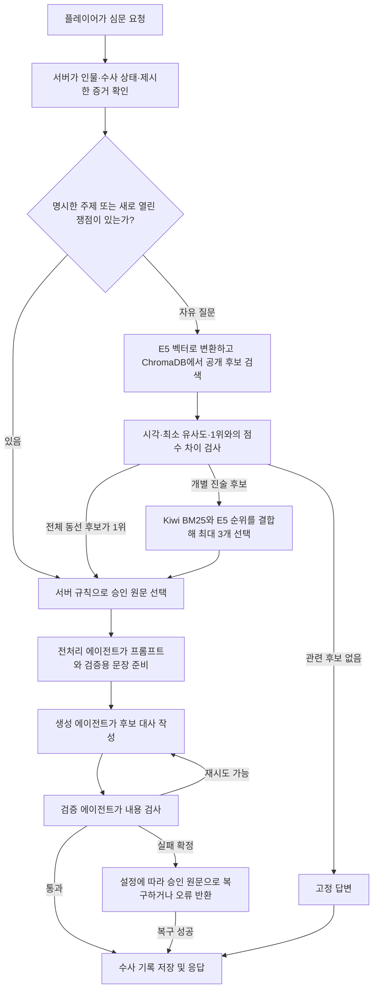

# 자유 심문 검색 개선

아래 비교는 `a199f18` 시점의 기록입니다. 이후 검색 실행 위치는 LangGraph 첫 노드로 이동했습니다. [현재 전처리 흐름](../에이전트/전처리/README.md)

팀 원본 **`af115f2`**에서 현재 **`feat/rag-free-questions`** 작업 트리까지의 변경을 정리합니다. 자유 질문을 받으면 현재 용의자가 말할 수 있는 진술 중에서 E5와 ChromaDB로 관련 후보를 찾고, Kiwi BM25로 순서를 조정합니다. 그렇게 선택한 원문을 바탕으로 Qwen이 인물의 대사를 작성합니다.

## 무엇이 바뀌었나요?

| 항목 | 팀 원본 `af115f2` | 현재 작업 트리 |
| --- | --- | --- |
| 자유 질문에서 진술 찾기 | 질문의 단어와 정규식을 검사해 주제나 진술을 선택 | 공개 가능한 진술에서 E5 벡터로 직접 검색하고 Kiwi BM25 순위를 결합 |
| 검색이 실행되는 위치 | 서버가 진술을 고른 뒤 전처리 에이전트에서 승인 사실을 다시 검색 | 생성 요청을 만들기 전에 서버의 자유 질문 검색에서 진술을 선택 |
| 검색 점수 | 사실 ID, 단어, 두 글자 조각의 일치 | ChromaDB의 코사인 유사도와 Kiwi 형태소 기반 BM25 순위를 사용 |
| 대사 준비 | 검색 결과와 승인 사실을 대조해 프롬프트에 전달 | 이미 선택한 승인 사실과 검증용 문장, 인물 정보, 최근 대화로 프롬프트를 작성 |
| 인물 말투 | 공통 말투를 모든 인물에게 전달 | 인물 데이터의 `speech_style`을 읽고, 값이 비어 있으면 공통 말투를 전달 |

예를 들어 “혹시 무슨 소리 못 들으셨나요?”를 받으면, 플레이어가 “코골이”라고 쓰지 않아도 **서재 문 밖에서 코 고는 소리를 들었다는 진술**을 검색할 수 있습니다. “오늘 점심 뭐 드셨어요?”는 확인한 API 실행에서 “지금 말씀드릴 수 있는 추가 내용은 없습니다.”로 처리됐습니다.

## 질문 하나가 처리되는 순서



- **공개 범위**는 서버가 정합니다. 현재 인물의 동선, 관계, 자기소개, 이미 공개된 인정 진술에서 후보를 만듭니다. ChromaDB에는 그 요청에서 허용된 벡터 ID만 넘깁니다. 근사 검색에서 일부 ID가 빠지면 해당 ID를 재조회하고, 그래도 누락되면 ChromaDB에서 해당 벡터만 읽어 코사인 거리를 직접 계산합니다. 인덱스는 백엔드 메모리에 있으며, 서버 재시작 후 필요한 벡터를 다시 적재합니다. [후보 구성](../../app/dialogue/preprocess_agent/question_search.py) · [ChromaDB 연결](../../app/dialogue/preprocess_agent/chroma_index.py)
- **E5 검색**에서 질문에는 `query: `, 진술에는 `passage: ` 접두어를 붙입니다. 개별 동선과 인정 진술은 제목, 가능한 경우 시각, 본문을 합쳐 임베딩합니다. 예를 들어 질문에 정확한 시각이 있으면 해당 시각과 맞는 진술만 남깁니다. [E5 인코더](../../app/dialogue/preprocess_agent/embeddings.py) · [진술 시각 검사](../../app/dialogue/preprocess_agent/testimony_time.py)
- **Kiwi BM25 재정렬**은 질문과 진술에서 형태소를 뽑습니다. “코를 골던”과 “코 고는”은 둘 다 `코`와 `골`로 연결할 수 있습니다. 가중 RRF는 개별 진술의 E5 순위와 BM25 순위를 **65%와 35%**로 결합합니다. E5 유사도 하한은 **0.8322**, 1위와의 점수 차이는 **0.02 이내**입니다. 이 기준을 통과한 후보를 재정렬한 뒤 최대 **3개**를 선택합니다. 전체 동선이 1위라면 조건에 맞는 동선 묶음을 사용합니다. [Kiwi 재정렬](../../app/dialogue/preprocess_agent/kiwi_reranker.py)
- **생성과 검증**에는 선택된 승인 사실, 필수 사실 ID, 인물의 이름·역할·말투, 질문, 최근 대화를 전달합니다. Qwen은 승인 사실을 자연스러운 대사로 재서술하고, 검증 단계는 필수 사실의 누락이나 승인되지 않은 내용의 추가를 검사합니다. 현재 사건 데이터에는 인물별 `speech_style` 값이 없어 기본 말투가 적용됩니다. [생성 프롬프트](../../app/dialogue/preprocess_agent/prompt.py) · [심문 요청 조립](../../app/investigation/service.py) · [검증 에이전트](../../app/dialogue/validation_agent_v1/agent.py)

## 코드와 설정에서 달라진 점

| 위치 | 변경 내용 |
| --- | --- |
| [서버 시작 코드](../../app/bootstrap.py) | E5, ChromaDB, Kiwi BM25를 서버에서 준비하고 심문 서비스에 연결합니다. |
| [전처리 에이전트](../../app/dialogue/preprocess_agent/agent.py) | 이전 `rag/retriever.py` 호출을 제거했습니다. 이제 승인 사실을 그대로 받아 프롬프트와 검증용 문장을 구성합니다. |
| [심문 서비스](../../app/investigation/service.py) · [진술 기록](../../app/investigation/rules/testimony.py) | 생성 전에 검색 결과를 승인 계획에 반영하고, 관계 진술은 개별 항목의 주제로 기록합니다. |
| [서버 설정](../../app/config.py) · [환경 변수 예시](../../.env.example) | E5 모델 경로, 최소 유사도, BM25 사용 여부, E5 가중치, RRF 상수를 설정할 수 있습니다. |
| [검색 평가 도구](../../scripts/retrieval_eval.md) | 질문과 정답 진술을 담은 데이터와 검색 지표 계산기를 추가했습니다. 코드에 포함된 평가 도구는 팀 원본의 어휘 점수 및 선택한 임베딩 모델의 비교에 사용합니다. 아래 ChromaDB·Kiwi 실험은 같은 질문에 실제 검색을 적용한 별도 평가입니다. |

Git 이력상 `71577c3`에서 E5 자유 검색을 도입했습니다. 그 뒤 작업 트리에서 진술의 제목·시각·본문을 검색에 활용하고, 기존 후단 검색을 제거한 다음 ChromaDB와 Kiwi BM25를 연결했습니다. Windows에서도 CSS 규칙 검사가 같은 결과를 내도록 테스트에서 읽는 파일의 줄바꿈을 통일했습니다. [프런트엔드 CSS 테스트 도우미](../../../click_detective_Next_js/tests/support/ui-contract.ts)

## 설치와 확인

기존 Python 가상환경을 활성화하고 저장소 루트에서 실행합니다.

```powershell
cd click_detective_FastAPI
python -m pip install -e ".[dev,retrieval]"
```

`.env.example`을 참고해 `.env`에 서버 API 키와 아래 검색 설정을 넣습니다. `models/retrieval`에 팀에서 준비한 `e5.onnx`와 `tokenizer.json`을 둡니다. 두 모델 파일은 별도로 준비합니다.

```dotenv
CLICK_GENERATION_MODE=fixture
CLICK_RAG_ENABLED=true
CLICK_RAG_EMBEDDING_DIR=./models/retrieval
CLICK_RAG_TOP_K=3
CLICK_RAG_MIN_SCORE=0.8322
CLICK_RAG_BM25_ENABLED=true
CLICK_RAG_DENSE_WEIGHT=0.65
CLICK_RAG_RRF_K=40
```

```powershell
python -m uvicorn app.main:app --host 127.0.0.1 --port 8000
python -X utf8 -m pytest -q
```

`fixture`는 E5·ChromaDB·Kiwi 검색을 실행하고 승인 원문을 조립해 답합니다. 실제 Qwen 대사를 확인하려면 `local` 모드와 별도로 준비한 모델·어댑터를 사용합니다. `CLICK_RAG_BM25_ENABLED=false`는 E5·ChromaDB 순위만 사용하고, `CLICK_RAG_ENABLED=false`는 기존 서버 규칙 경로를 사용합니다. [백엔드 실행 안내](../../README.md)

프런트엔드 전체 수사 검사는 `click_detective_Next_js`에서 실행합니다. 백엔드 의존성을 설치한 Python을 사용하며, 통합 검사 스크립트가 로컬 Next.js와 FastAPI 서버를 시작하고 종료합니다.

```powershell
npm ci
npm test
npm run typecheck
npm run build
$env:CLICK_TEST_PYTHON = (Get-Command python).Source
$env:CLICK_RAG_EMBEDDING_DIR = (Resolve-Path '..\click_detective_FastAPI\models\retrieval').Path
$env:CLICK_RAG_ENABLED = 'true'
$env:CLICK_RAG_BM25_ENABLED = 'true'
npm run test:integration
```

## 검증 결과

- Windows에서 두 앱 의존성을 새로 설치하고 서버를 시작했습니다. 백엔드 테스트 **78개**와 프런트엔드 테스트 **13개**, TypeScript 검사 및 Next.js 프로덕션 빌드가 통과했습니다.
- Next.js에서 FastAPI까지 이어지는 통합 검사에서 HTTP 요청 **207건**을 확인했습니다. 새 수사를 열고 증거·쟁점·추론을 모은 뒤 고발까지 진행해 수사 진행률과 고발 점수가 각각 **100**이었습니다.
- Edge로 새 수사를 시작해 자유 질문 **3건**을 보냈습니다. 유언장 관련 진술이 먼저 선택됐고, Enter로 보낸 소리 질문은 코골이 진술에 연결됐습니다. 점심 질문은 고정 답변으로 처리됐습니다. 새로고침 후 같은 수사에서 질문 횟수와 증언 기록을 다시 확인했습니다.
- 실제 E5·ChromaDB·Kiwi에서 공동 조정 평가 질문 **403건**을 재실행해 최종 설정에서 선택한 진술이 실험 결과와 일치하는 것을 확인했습니다. 근사 검색이 두 번 누락한 승인 후보의 벡터만 읽어 점수를 복구하는 경로도 검사했습니다.
- 심문 API에서 “받아서 챙겨 둔 게 유언장 최종본이었나요, 아직 작성 중인 문서였나요?”를 보냈을 때 E5 순위에서는 자기소개가 먼저 나왔고, Kiwi BM25를 켜면 **유언장 관련 면담 진술**이 먼저 나왔습니다. 명시된 시각의 코골이 질문과 사건 외 질문도 함께 확인했습니다.
- 유사도 하한, 1위와의 점수 차이, E5 가중치, RRF 상수의 **1,706,900개 조합**을 질문 218건과 기존 검증 질문 135건으로 비교했습니다. 기존값 대비 필요한 진술 전체 선택, 정답 진술만 선택, 복합 질문의 전체 선택이 줄거나 오탐이 늘어난 설정은 제외했습니다. 적용한 값은 **최소 유사도 0.8322, 최대 점수 차이 0.02, E5 0.65 / BM25 0.35, RRF 상수 40**입니다.
- RRF 상수를 20에서 40으로 바꾸자 기존 검증 세트에서 관련 진술이 1위인 질문이 **63/90 → 65/90**으로 늘었습니다. 별도로 만든 50건에서는 1위 적중 **24/35**, 필요한 진술 전체 선택 **21/35**, 오탐 **4/15**로 두 설정이 같았습니다.

| 기존 가중치 검증 질문 50건 | E5·ChromaDB | E5·ChromaDB + Kiwi BM25 (RRF 상수 40) |
| --- | ---: | ---: |
| 관련 진술이 1위 | 17/35 | 24/35 |
| 필요한 진술을 모두 선택 | 18/35 | 19/35 |
| 필요한 진술만 정확히 선택 | 8/35 | 8/35 |
| 답할 근거가 없는 질문에 진술 선택 | 2/15 | 2/15 |

이번 개선은 관련 진술의 순위를 올리는 데 효과가 있었습니다. 오탐과 모델의 실제 대사 품질은 별도의 평가 항목입니다. 심문 API 검증에서는 실제 검색과 fixture 응답을 사용했습니다. [심문 검색 테스트](../../tests/dialogue/test_question_search.py) · [ChromaDB 테스트](../../tests/dialogue/test_chroma_index.py) · [Kiwi 재정렬 테스트](../../tests/dialogue/test_kiwi_reranker.py)
