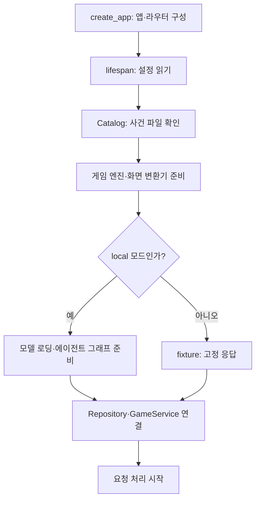
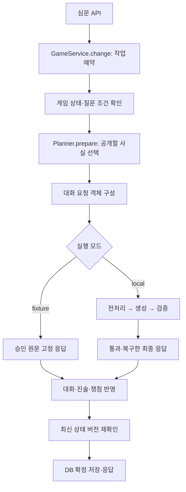

# 전체 처리 흐름

[전체 목차](../README.md) · 이전: [설치와 실행](02_설치와_실행.md) · 다음: [코드 읽는 순서](04_코드_읽는_순서.md)

## 서버 시작

[main.py](../../app/main.py)의 `create_app`은 앱과 도메인별 라우터를 연결한다. 실제 데이터·DB·모델 준비는 서버가 시작될 때 [bootstrap.py](../../app/bootstrap.py)의 `lifespan`에서 수행한다.

API 경로는 `main.py` 한 파일에 모두 들어 있지 않다. 사건 API는 `cases/routes.py`, 수사 행동은 `investigation/routes.py`, 자료와 화면은 해당 폴더의 `material_routes.py`, `view_routes.py`에 있다.

## 조회 요청

사용자 요청 → 서비스 키 확인 → 수사 토큰·사건 버전 확인 → 저장 상태 읽기 → 화면용 정보 구성 → 응답 순서다. 수사와 관계없는 카탈로그 조회에는 수사별 토큰이 필요하지 않다. GET 요청으로 질문 수나 열람 상태를 변경하지 않는다.

## 질문 하나의 처리

`Planner`는 그래프 실행 전에 승인 사실과 기록 계획을 만든다. 그래프의 전처리 에이전트는 그 사실 안에서 검색하고 프롬프트를 준비한다. 두 단계 모두 전처리 폴더에 있지만 호출 시점은 다르다.

검증을 통과하지 못한 후보는 설정에 따라 새로 생성하거나 승인 원문으로 복구한다. 복구가 비활성화되어 오류로 끝나면 기록과 확정 저장에 도달하지 않는다. 자세한 분기는 [응답·복구 정책](../에이전트/응답과_복구_정책.md)에 있다.

## 저장은 마지막에 확정한다

[Repository.reserve](../../app/investigation/repository.py)는 작업을 예약하고 상태 사본을 준다. 모델 실행 동안 DB 트랜잭션을 계속 열어 두지 않는다. `Repository.commit`에서 예약 소유권과 최신 revision을 다시 검사한다.

생성 중 다른 행동이 먼저 저장되면 오래된 응답을 새 상태에 덮어쓰지 않고 거절한다. 마지막 정리 단계인 `abort`는 남아 있는 자신의 미완료 예약만 정리한다. 성공한 저장을 취소한다는 뜻은 아니다.

상세 저장 규칙은 [상태와 SQLite](../서버/상태와_SQLite_저장.md), 모델 내부 순서는 [에이전트 전체 흐름](../에이전트/README.md)에서 확인한다.
