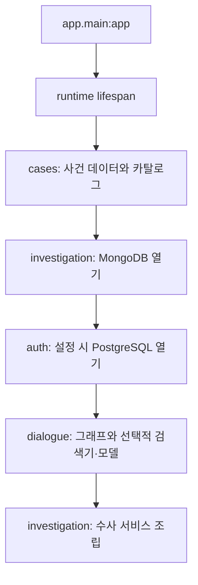

# 서버 시작과 요청 처리

## 앱 시작

`app.main:app`은 `create_app()`에서 라우터와 공통 오류 처리를 등록한다. `create_app(settings=...)`로 설정을 전달하면 lifespan이 해당 객체를 사용한다. 기본 실행은 서버가 시작될 때 프로젝트의 `.env`와 프로세스 환경변수를 읽는다. [앱 진입점](../../app/main.py) · [runtime 설정](../../app/runtime/runtime_settings.py)

lifespan은 provider에서 받은 객체를 앱 상태에 보관한다. 앱이 종료되거나 시작 중 오류가 나면 준비된 검색 인덱스와 DB 연결을 정리한다. [lifespan](../../app/runtime/runtime_lifespan.py)

## 조회

서버 간 Bearer 인증을 통과한 요청은 해당 도메인의 컨트롤러로 간다. 사건 카탈로그는 공개 항목만 조립한다. 수사별 조회는 계정 또는 익명 토큰으로 접근 권한을 확인하고, 현재 상태와 열람 조건을 반영한 응답을 반환한다. [서비스 인증](../../app/runtime/runtime_auth.py) · [카탈로그 서비스](../../app/cases/services/cases_catalog_service.py) · [수사 컨트롤러](../../app/investigation/controllers/investigation_game_controller.py)

## 심문과 저장

1. 수사 서비스가 UUID와 revision을 확인하고 행동을 예약한다. 승인된 심문은 접수 시 질문을 차감한다.
2. 심문 계획이 인물·자료·쟁점 조건을 평가하고 대화 DTO를 만든다.
3. 대화 서비스가 전처리, 후보 생성, 검증을 실행한다. 복구가 허용되면 중립 대사를 사용한다.
4. 수사 서비스가 대사와 기록할 계획을 받아 최신 revision과 예약 실행권을 확인한 뒤 확정한다. 실패 시 자신이 보유한 예약을 정리한다.

[수사 서비스](../../app/investigation/services/investigation_game_service.py) · [대화 서비스](../../app/dialogue/services/reply/dialogue_reply_service.py) · [수사 저장](../서버/수사_저장.md)
