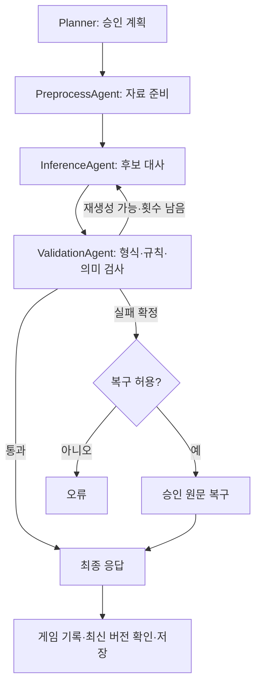

# 멀티 에이전트 전체 흐름

[전체 목차](../README.md) · [전처리](전처리/README.md) · [생성](생성/README.md) · [검증](검증/README.md)

이 프로젝트의 멀티 에이전트는 질문 처리를 세 역할로 나눈 구조다. 전처리는 일반 Python 코드로 수행한다. 생성과 의미 검증은 같은 로컬 모델을 서로 다른 목적과 프롬프트로 호출한다.

| 단계 | 담당 클래스 | 역할 | 모델 호출 |
|---|---|---|---|
| 1. 전처리 | `PreprocessAgent` | 승인 사실 검색·생성 자료 준비 | 없음 |
| 2. 생성 | `InferenceAgent` | 자연스러운 후보 대사 작성 | `purpose="dialogue"` |
| 3. 검증 | `ValidationAgent` | 형식·의미 검사, 재생성·복구 판단 | 의미 검사에서 `purpose="verification"` |

## 세 단계를 연결하는 클래스

```python
class InterrogationGraph:
    ...
```

[실제 코드](../../app/dialogue/interrogation_graph.py) · [클래스·함수 참조](../코드참조/app/dialogue/interrogation_graph.md)

생성할 때 설정과 공용 모델을 받아 세 에이전트 객체를 만든다. LangGraph에 `preprocess_agent`, `inference_agent`, `validation_agent` 노드를 연결한다. 그래프의 각 메서드는 해당 에이전트 객체에 작업을 전달한다.



서버 규칙이 먼저 공개 사실을 결정한다. 에이전트가 정답이나 새 쟁점을 임의로 결정하지 않는다. 그래프는 순차 실행하며, GPU 모델 호출도 잠금으로 직렬화한다.

## 함께 사용하는 작업 기록

```python
class InterrogationState(TypedDict, total=False):
    ...
```

[실제 코드](../../app/dialogue/state.py)

| 값 | 의미 |
|---|---|
| `request` | 질문·인물·승인 사실·필수 사실 ID |
| `messages`, `retrieval` | 생성 프롬프트와 검색 결과 |
| `raw_output` | 생성한 후보 대사 원문 |
| `attempt` | 대사 생성 누적 횟수 |
| `error_status` | 모델 실행 오류 |
| `retry`, `rejection_code` | 재생성 여부와 거절 이유 |
| `response` | 최종 응답 |

각 노드는 필요한 결과만 딕셔너리로 반환하고, LangGraph가 작업 기록을 다음 단계로 전달한다. 중간 작업 기록 전체를 게임 DB에 저장하지 않는다.

## 제한 시간과 결과

`InterrogationGraph.generate`는 전처리·생성·검증·재시도 전체에 시간 제한을 적용한다. 재생성할 때마다 전체 제한 시간이 새로 주어지는 것은 아니다.

응답의 `finish_reason`은 `stop`(생성·검증 성공), `fixed`(고정 대사), `fallback`(실패 후 원문 복구)로 구분한다. 의미 검증은 확률적 모델 판단과 제한된 규칙을 결합하므로 오류를 완벽하게 막는다는 뜻은 아니다.

다음으로 [전처리](전처리/README.md), [생성](생성/README.md), [검증](검증/README.md)을 순서대로 읽는다. 모델 준비는 [공용 모델](공용_모델.md), 실패 분기는 [응답·복구 정책](응답과_복구_정책.md), 검색과 표현 설정은 [검색과 표현 자유도](검색과_표현_자유도.md)를 참고한다.
