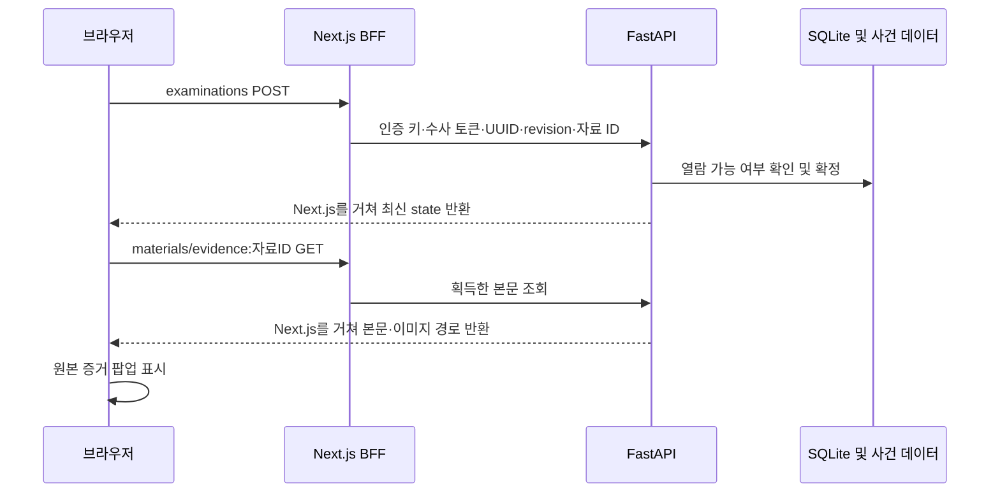

# 프로젝트 구조와 데이터 흐름

## 1. 세 가지 실행 위치

화면에서 버튼 하나를 눌러도 코드가 실행되는 장소는 나뉩니다.

| 위치         | 하는 일                                      | 보관하는 것                                |
| ------------ | -------------------------------------------- | ------------------------------------------ |
| 브라우저     | 원본 화면 렌더링·입력·메뉴 이동·팝업         | 질문 초안, 선택 메뉴, 메모 초안 등 UI 상태 |
| Next.js 서버 | 허용된 API 중계·쿠키 설정·인증 헤더 추가     | 서버 환경변수의 API 키                     |
| FastAPI      | 사건 조회·권한 검사·규칙 판정·대사 생성·저장 | 사건 데이터, SQLite, 모델·어댑터           |

브라우저의 버튼 비활성화는 사용 편의를 위한 표시입니다. 실제로 그 행동이 가능한지는 FastAPI가 다시 검사합니다.

## 2. 프로젝트 폴더

```text
click_detective_nextjs/
  app/
    page.tsx
    layout.tsx
    globals.css
    styles/                         원본 화면 CSS 6개
    api/detective/[...segments]/route.ts
    assets/[...asset]/route.ts
    manor.jpg/route.ts
  components/
    original-app-loader.tsx
    case-app.tsx
    app-header.tsx
    investigation-sidebar.tsx
    navigation.ts
    case-opening.tsx
    evidence-dialog.tsx
    game-dialog.tsx
    screens/                        원본 화면 12개
  hooks/
    use-case-game.ts
    use-screen-view.ts
  lib/
    case.ts
    game-client.ts
    client-api.ts
    case-library.ts
    investigation-*.ts              서버 값을 읽는 표시 보조 모듈
    inference-sources.ts
    accusation-requirements.ts
    interview-topics.ts
    evidence-illustrations.ts
    server/proxy-policy.ts
  tests/
  scripts/
  docs/
  .env.local
  package.json
  package-lock.json
```

`[...segments]`는 여러 경로 조각을 받는 Next.js 폴더 이름입니다. 예를 들어 `/api/detective/materials/evidence%3A1-01`도 하나의 중계 진입점에서 처리할 수 있습니다. 이 진입점은 허용 목록을 검사하므로 임의 주소로 전달하는 범용 프록시는 아닙니다.

## 3. 첫 접속 과정

1. `app/page.tsx`가 `OriginalAppLoader`를 표시합니다.
2. 로더가 `/api/detective/catalog`를 호출합니다.
3. Next.js가 서버 API 키를 붙여 FastAPI `/v1/catalog`를 호출합니다.
4. 받은 인물·선택지·자료 메타데이터·사건 카드·표시 목표를 `installCatalog` 등의 함수로 준비합니다.
5. 준비가 끝나면 원본 `CaseApp`을 표시합니다.
6. `useCaseGame`이 `state` API로 현재 수사 쿠키에 연결된 기록을 복원합니다.

카탈로그 로딩과 수사 복원은 역할이 다릅니다. 카탈로그는 공개 화면 자료이고, 수사 상태는 특정 게임의 진행 기록입니다. 카탈로그를 받지 못하면 원본 화면을 데이터 없이 시작하지 않고 연결 오류와 재시도 버튼을 표시합니다.

`case.ts`의 내보낸 배열은 원본 컴포넌트와 연결하기 위한 브라우저 메모리의 표시 자료입니다. 파일 DB나 프런트엔드 정답 데이터가 아닙니다.

## 4. 자료를 열었을 때



이미 획득한 자료는 열람 변경을 반복하지 않고 본문을 조회합니다. 목록 GET이나 검색 자체가 열람을 확정하지는 않습니다.

## 5. 심문을 보냈을 때

```text
원본 심문 화면
  → useCaseGame.submitQuestion
  → requestGame('interrogate', 입력)
  → 기존 필드 이름을 FastAPI 형식으로 변환
  → Next.js BFF
  → FastAPI가 획득 자료·단계·횟수 확인
  → LangGraph 전처리 → 모델 생성 → 검증
  → 승인된 대화·증언·쟁점 저장
  → 새 state를 원본 말풍선·자료·쟁점 화면에 반영
```

전처리·생성·검증 에이전트는 FastAPI 백엔드에 있습니다. Next.js가 별도 LangGraph를 생성하거나 브라우저에 모델을 로딩하지 않습니다. fixture 모드에서는 실제 모델 생성 대신 명시적 테스트 응답 경로를 사용합니다.

## 6. 어떤 데이터가 어디에 있는가

| 데이터                     | 공식 원본 또는 저장 위치   | 프런트엔드 사용 방식         |
| -------------------------- | -------------------------- | ---------------------------- |
| 사건 소개·인물·주제·선택지 | FastAPI 사건 데이터        | 카탈로그 응답 표시           |
| 자료 제목·요약·장소        | FastAPI 사건 데이터        | 목록과 화면 조회 응답 표시   |
| 원본 자료 본문·이미지      | FastAPI 데이터 및 보호 API | 열람 권한 확인 후 표시       |
| 실제 심문·증언·발견 쟁점   | FastAPI 수사 상태          | state 및 화면 조회 응답 표시 |
| 생성된 추론                | FastAPI 판정·저장 결과     | 본문·출처·제출 선택 표시     |
| 진행률·2차 조사·고발 준비  | FastAPI 계산               | 받은 값을 표시               |
| 메모                       | FastAPI SQLite 수사 상태   | 입력 초안 보관 후 자동 저장  |
| 현재 메뉴·모바일 메뉴·팝업 | React UI 상태              | 브라우저 내에서 변경         |
| 오프닝 표시 여부           | 브라우저 localStorage      | 영상 자동 표시의 UX만 관리   |

화면을 그리기 위한 출처 제목 찾기, 시간대별 배치, 체크박스 선택 등은 여전히 UI 코드에 있습니다. 게임 정답 판정·진행 조건·공식 저장을 수행하는 코드와 구분하세요.

## 7. 원본 자산 주소를 유지하는 방법

원본 CSS와 영상 컴포넌트는 `/manor.jpg`, `/assets/notebook-paper.png`, `/assets/intro/...mp4`를 사용합니다. 이 주소를 바꾸면 CSS나 컴포넌트까지 달라지므로 같은 주소에 Route Handler를 둡니다.

```text
/manor.jpg
  → /v1/assets/manor.jpg

/assets/notebook-paper.png
  → /v1/assets/assets/notebook-paper.png
```

두 번째 주소의 `assets/assets`는 오타가 아닙니다. 첫 `assets`는 API 이름이고 두 번째는 백엔드 public 아래 실제 폴더입니다. 파일은 FastAPI 사본에서 읽습니다. 원본 `share_project/public`은 일반 실행 중에 필요하지 않습니다.

다음 문서: [화면 사용법](03_화면_사용법.md)

## 답변과 쟁점의 분리

FastAPI의 GameService.reply는 생성·검증 오류를 승인 원문 fallback으로 복구합니다. 원본 심문 말풍선은 stop·fixed·fallback의 최종 reply를 같은 위치에 표시합니다. 실패한 모델 후보는 표시하지 않으며 쟁점은 승인 계획 조건에 따라 기록합니다.
