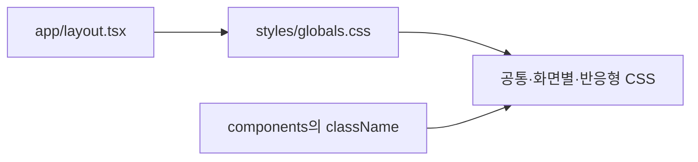

# CSS 구조와 적용 순서

CSS는 모두 프로젝트 루트의 `styles/`에 있습니다. `app`과 `components`에는 CSS 파일을 두지 않습니다.

## 시작 파일과 실제 적용 순서

[app/layout.tsx](../../app/layout.tsx)가 전역 CSS를 한 번 가져옵니다.

```ts
import '../styles/globals.css';
```

[styles/globals.css](../../styles/globals.css)는 다음 순서로 스타일을 연결합니다.

```text
외부 웹폰트
→ base.css
→ home.css
→ library.css
→ investigation.css
→ dialogs.css
→ responsive.css
```

같은 선택자와 우선순위라면 뒤의 선언이 앞의 값을 덮어쓸 수 있습니다. 기존 화면 모양을 유지하려면 이 순서를 지켜야 합니다.

## 어디를 수정할까?

| 위치 | 사용하는 곳 |
| --- | --- |
| [base.css](../../styles/base.css) | 공통 색상·글자·버튼·기본 요소 |
| [home.css](../../styles/home.css), `home/` | 홈·소개 영역 |
| [library.css](../../styles/library.css) | 사건 카드·사건 기록실 |
| [investigation.css](../../styles/investigation.css), `investigation/` | 수사 화면·문서·대화·결과 |
| [dialogs.css](../../styles/dialogs.css) | 문서·안내 팝업 |
| [responsive.css](../../styles/responsive.css), `responsive/` | 화면 폭에 따른 조정과 뒤에서 적용하는 보완 규칙 |

큰 CSS는 `part-01.css`처럼 순서대로 나눴습니다. 상위 파일의 `@import`가 실제 적용 순서입니다. 같은 `@media` 조건이나 선택자가 여러 파일에 나오는 것은 기존 규칙 순서를 보존하기 위한 것입니다.

## 화면 컴포넌트와의 연결



컴포넌트의 `className`이 CSS 선택자와 연결됩니다. 자료 본문에 쓰이는 이미지 주소와 영상 주소는 FastAPI 자산 중계를 사용합니다. CSS의 파일 위치를 바꿀 때는 `@import` 경로와 `layout.tsx`의 import를 함께 확인합니다.

## 확인 방법

```bash
npm test
npm run build
```

단위 검사는 CSS의 조건·선택자·속성·적용 순서 679개를 기준 자료와 비교합니다. 실제 화면의 픽셀 비교는 별도의 [브라우저 검사](../테스트/검사와_오류해결.md)를 사용합니다. 비교할 때는 양쪽의 글꼴·화면 폭·수사 상태도 같아야 합니다.

[폴더 구조](폴더_구조.md) · [전체 문서](../README.md)
