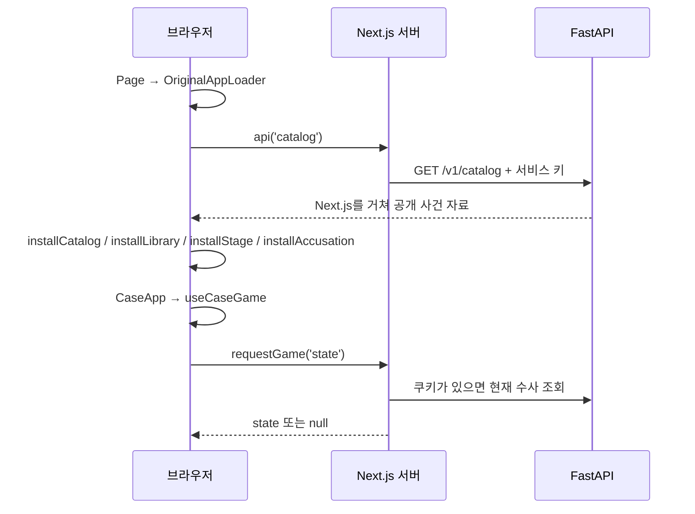
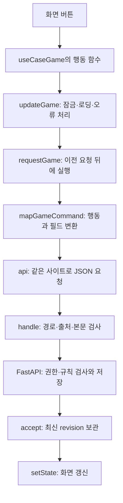

# 실행 순서와 함수 연결

## 1. 첫 접속



1. `app/page.tsx`의 `Page`가 `OriginalAppLoader`를 표시합니다.
2. 로더가 `api<PublicCatalog>('catalog')`를 호출합니다.
3. 인물 이미지 주소를 `assetUrl`로 바꾸고 공개 자료·사건 카드·표시 기준을 설치합니다.
4. 준비되면 `CaseApp`이 실행됩니다. 실패하면 연결 오류와 재시도 버튼을 보여줍니다.
5. `useCaseGame`이 `useRestoreGame`을 호출해 저장된 수사와 메모를 복원합니다.
6. 쿠키가 없으면 수사 상태는 `null`이고, 홈에서 새 수사를 시작할 수 있습니다.

카탈로그는 공개 화면 자료이며, 수사 상태는 특정 게임의 진행 기록입니다.

## 2. 공통 변경 요청



`updateGame`은 중복 클릭을 막고 `busy`를 설정합니다. `requestGame`은 메모 저장과 심문이 동시에 저장 버전을 쓰지 않도록 순서대로 처리합니다. FastAPI 응답이 오면 `accept`가 오래된 버전으로 되돌아가지 않게 확인하고, `setState`가 화면을 갱신합니다. 실패하면 오류를 표시하고 이미 확인한 최신 상태를 유지합니다.

## 3. 새 수사·이어하기

`startInvestigation(restart)` → `updateGame('start', ...)` → `requestGame` 순서입니다. 이어하기는 메모리의 수사가 있으면 그 기록을 사용합니다. 새 수사는 카탈로그의 `caseId`, `scenarioVersion`과 UUID로 생성합니다. 서버 중계의 `gameCreated`가 수사 ID·토큰을 HttpOnly 쿠키에 저장하고 JSON에는 상태만 반환합니다. 성공 후 브리핑 또는 결과 화면으로 이동합니다.

## 4. 증거 열람

1. `EvidenceScreen`의 카드가 `openEvidence(id)`를 호출합니다.
2. 원본 증거를 아직 읽지 않았다면 `updateGame('examine', { evidenceId: id })`로 열람을 확정합니다.
3. 확보한 증언·추론 또는 이미 읽은 증거라면 열람 변경 요청을 생략합니다.
4. `requestDocument(id, readableState)`가 자료 종류를 정해 상세 API를 호출합니다.
5. 본문과 이미지를 준비한 뒤 `selectedDoc`, `doc`을 바꿉니다.
6. `EvidenceDialog`가 문서를 표시합니다. 목록 검색만으로 열람 완료가 되지는 않습니다.

## 5. 심문

```ts
async function submitQuestion(e: React.FormEvent)
```

폼 제출 기본 동작을 막고 인물·질문·선택 주제·첨부 자료를 `updateGame('interrogate', ...)`에 전달합니다. `mapGameCommand`가 `suspectId`를 `suspect_id`, `evidenceId`를 `material_id`로 바꿉니다. FastAPI가 자료·횟수·단계를 검사하고 에이전트 처리를 수행합니다. 성공한 최신 상태에 말풍선·증언·쟁점이 포함되며, 질문·주제·첨부 입력을 비웁니다. 말풍선 스크롤은 `useMessageScroll`이 담당합니다.

## 6. 메모 저장

`NotesScreen` 입력 → `setNotes` → `useNotesAutosave` 순서입니다. 입력이 700ms 멈추고 다른 화면 행동을 처리 중이 아니면 `requestGame('notes', { text })`를 큐에 넣습니다. 응답이 왔을 때 입력이 더 바뀌지 않았어야 저장됨으로 표시합니다. 뒤늦은 응답이 최신 초안을 덮어쓰지 않도록 참조를 사용합니다. 저장 실패는 재저장 안내를 표시하고, 미저장 메모가 있으면 탭 종료 시 브라우저에 알립니다.

## 7. 목록 검색과 화면 이동

`useScreenView`는 화면 이름·검색 조건·수사 ID·revision이 바뀔 때 서버의 화면 조회 API를 호출합니다. 이전 화면의 늦은 응답은 적용하지 않습니다. `navigateTo`는 메뉴를 바꾸고 모바일 메뉴·문서·오류를 정리합니다. 화면 이동 자체는 수사 기록을 변경하지 않습니다.

이어 읽기: [수사 상태 코드](../코드참조/investigation.md), [서버 중계 코드](../코드참조/서버중계.md)
