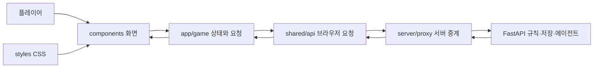

# 코드를 보여주며 설명하는 발표 순서

이 발표는 Next.js 화면에서 일어난 행동이 FastAPI까지 전달되고 다시 화면에 반영되는 과정을 설명합니다. AI 에이전트의 내부 실행은 [FastAPI 문서](../../../click_detective_FastAPI/docs/README.md)에서 이어 설명합니다.

## 1. 전체 구조를 먼저 보여주기



설명: 화면은 `components`, 상태와 요청은 `app/game`, CSS는 `styles`입니다. Next.js 서버는 비밀 키와 수사 쿠키를 사용해 FastAPI로 요청을 전달합니다.

## 2. 처음 접속할 때

보여줄 소스: [page.tsx](../../app/page.tsx), [original-app-loader.tsx](../../components/application/original-app-loader.tsx)

```ts
export default function Page()
export function OriginalAppLoader()
```

설명: `Page`가 로더를 표시합니다. 로더는 공개 사건 자료를 받은 뒤 화면에 필요한 목록과 표시 기준을 준비하고 `CaseApp`을 표시합니다. 이어서 저장된 수사를 복원합니다.

## 3. 화면과 행동을 연결하는 중심 함수

보여줄 소스: [use-case-game.ts](../../app/game/investigation/use-case-game.ts)

```ts
export function useCaseGame()
async function updateGame(action: string, body: unknown)
```

설명: `useCaseGame`은 현재 화면·질문·메모·팝업과 수사 상태를 관리합니다. `updateGame`은 버튼의 중복 실행을 막고 로딩·성공·오류를 공통 처리합니다.

## 4. 증거 카드 하나를 눌렀을 때

```ts
async function openEvidence(id: string)
```

설명: 아직 읽지 않은 원본 자료라면 먼저 열람 기록을 저장합니다. 그 뒤 상세 본문을 받아 문서 팝업을 엽니다. 이미 확보한 증언·추론이나 읽은 자료는 열람 기록을 중복해서 변경하지 않습니다.

발표 중에는 증거 카드 → 문서 팝업 → 열람 완료 표시를 직접 보여주면 됩니다.

## 5. 행동을 서버 요청으로 바꾸기

보여줄 소스: [game-client.ts](../../app/game/investigation/game-client.ts), [commands.ts](../../app/game/investigation/commands.ts)

```ts
export function requestGame(action: string, body?: unknown): Promise<GameState | null>
export function mapGameCommand(action: string, input: Record<string, unknown>)
```

설명: `requestGame`이 요청을 순서대로 보내며 UUID와 현재 저장 버전을 붙입니다. `mapGameCommand`는 `examine`을 `examinations`, `evidenceId`를 `evidence_id`로 바꿉니다. 이 함수가 자료 획득이나 정답을 판정하지는 않습니다.

## 6. Next.js 서버를 거치는 이유

보여줄 소스: [handle.ts](../../server/proxy/handle.ts)

```ts
export async function handle(
  request: NextRequest,
  context: { params: Promise<{ segments: string[] }> },
)
```

설명: 요청 출처·허용 경로·본문을 검사합니다. 수사 쿠키를 읽고 서버의 서비스 키를 붙여 FastAPI로 보냅니다. 생성 응답의 토큰은 HttpOnly 쿠키로 저장하고 브라우저 JSON에는 수사 상태만 반환합니다.

## 7. 응답 이후 화면이 바뀌는 이유

FastAPI가 최신 상태를 반환하면 `accept`가 저장 버전을 확인하고, `updateGame`의 `setState`가 React 화면을 갱신합니다. 심문 성공 후에는 질문·첨부 입력을 비우고 새 말풍선을 보여줍니다. 메모는 입력이 700ms 멈추면 같은 요청 큐로 자동 저장됩니다.

발표를 마무리할 때는 [검증 기록](../테스트/검증_기록.md)을 보여주세요. fixture에서 확인한 게임·화면 동작과 실제 GPU·LLM 품질 검사의 범위를 구분해 설명하면 됩니다.

[함수별 입력·반환 설명](../코드참조/README.md) · [자세한 처리 순서](../구조/동작_순서.md) · [전체 문서](../README.md)
