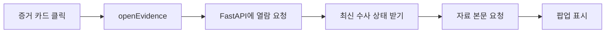

# 처음 보는 사람을 위한 안내

이 프로젝트는 탐정 게임의 화면입니다. 버튼을 그리고 입력을 받는 일은 Next.js가 담당하며, 사건의 정답을 판단하고 수사 기록을 저장하는 일은 FastAPI가 담당합니다.

## 기본 용어

| 용어 | 쉬운 설명 | 코드에서의 예 |
| --- | --- | --- |
| 컴포넌트 | 화면의 한 부분을 만드는 함수 | `EvidenceScreen`은 증거 목록 |
| props | 화면 함수에 전달하는 재료 | 현재 수사 상태, 클릭했을 때 실행할 함수 |
| state | 바뀔 때 화면을 다시 그리게 하는 값 | 질문 입력, 선택 메뉴 |
| 훅 | React 상태나 화면 효과를 묶은 함수 | `useCaseGame` |
| API | 다른 프로그램에 요청을 보내는 창구 | 증거 열람 요청 |
| BFF | 브라우저와 FastAPI 사이의 Next.js 서버 | `/api/detective/...` |
| Promise | 나중에 완료될 작업의 결과 | 서버 응답을 기다리는 값 |
| async / await | 응답을 기다리는 코드를 쓰는 문법 | `await requestGame(...)` |
| JSDoc | 함수 위에 쓰는 사용 설명 주석 | `@param`, `@returns` |

## 증거 카드를 클릭하면



1. `features/materials/evidence-screen.tsx`가 증거 카드를 그립니다.
2. 카드에 전달된 `openEvidence`가 실행됩니다.
3. 아직 열람하지 않았다면 `updateGame('examine', ...)`으로 서버에 기록합니다.
4. `requestDocument`가 본문을 가져옵니다.
5. 선택 문서 상태를 바꾸면 `EvidenceDialog`가 팝업을 표시합니다.

## 함수를 읽는 방법

```ts
export function requestGame(action: string, body?: unknown): Promise<GameState | null>
```

- `action`은 `examine`, `interrogate` 같은 행동 이름입니다.
- `body?`의 물음표는 입력을 생략할 수 있다는 뜻입니다.
- `Promise<GameState | null>`은 기다린 뒤 수사 상태 또는 `null`을 받는다는 뜻입니다.
- 본문에서는 요청을 순서대로 보내고, 성공한 최신 상태를 보관합니다.

화면 파일의 `Props`는 그 화면이 받는 입력의 목록입니다. `Pick<CaseGameController, ...>`은 컨트롤러가 가진 값 중 해당 화면에 필요한 항목만 가져오는 TypeScript 표기입니다. `Omit<..., 'state'>`은 기존의 비어 있을 수도 있는 상태 타입을 빼고, 화면에서 필수인 `GameState`로 다시 적기 위해 사용합니다.

## 어디부터 수정할까?

화면 문구·배치는 해당 `features/기능명/*-screen.tsx`, 질문 전송은 `features/investigation/use-case-game.ts`, 행동 이름 변환은 `commands.ts`, 서버 중계는 `server/proxy/handle.ts`를 봅니다. 게임 규칙·대사 에이전트는 FastAPI에서 수정합니다.

이어서 [동작 순서](../구조/동작_순서.md)와 [실제 코드 선언](../코드참조/README.md)을 읽어보세요.
